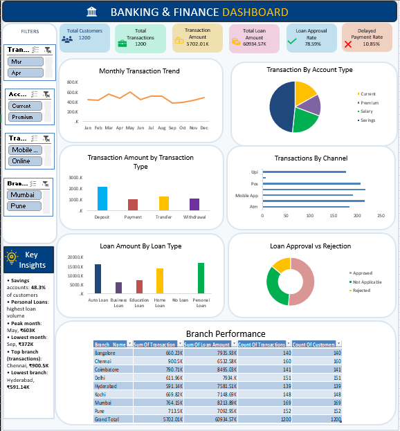

# Banking Customer Transaction & Financial Performance Analysis

## 1. Project Aim

To analyze banking customer transactions, account activity, loan performance and financial trends using Microsoft Excel, in order to:

- Understand **customer behavior** (which accounts, channels and transaction types customers prefer)
- Identify **revenue and transaction patterns** across months and branches
- Detect **loan risks** (approval/rejection, delayed payments, outstanding balances)
- Recommend **opportunities** to improve the bank's financial performance

### Key Business Questions

|   | Question | Answered By |
|---|----------|-------------|
| 1 | How many customers and transactions does the bank have, and what is the total transaction value? | KPI cards |
| 2 | How do transactions trend month by month? Which months peak and dip? | Monthly Transaction Trend |
| 3 | Which account type is most common? | Transaction by Account Type |
| 4 | Which transaction type (Deposit, Payment, Transfer, Withdrawal) generates the most value? | Transaction Amount by Type |
| 5 | Which channel (UPI, POS, ATM, Mobile App, Online, Branch) is used most? | Transactions by Channel |
| 6 | Which loan type has the highest loan amount? | Loan Amount by Loan Type |
| 7 | What share of loan applications are approved vs rejected? | Loan Approval vs Rejection |
| 8 | Which branch performs best and which lags behind? | Branch Performance table |
| 9 | What is the loan approval rate and delayed payment rate? | KPI cards |
| 10 | How many transactions fail or remain pending, and how much value is at risk? | Additional analysis |
| 11 | Which loan type and which branch have the most delayed payments? | Additional analysis |
| 12 | Which account type holds the highest average balance? | Additional analysis |
| 13 | Which customer segment and age group are the largest? | Additional analysis |
| 14 | How much of the total loan amount is still outstanding? | Additional analysis |

## 2. Dataset Description

- **Source file:** `Cleaned_Banking_Dataset.xlsx` (sheet: `Cleaned`)
- **Size:** 1,200 rows × 22 columns (one row per customer, each with one transaction record)
- **Period covered:** 1 January 2025 – 31 December 2025
- **Unique records:** 1,200 unique Customer IDs and 1,200 unique Transaction IDs
### Column Dictionary

| Group | Column | Description |
|-------|--------|-------------|
| Customer | Customer_ID, Customer_Name | Unique ID and name of the customer |
| Customer | Age | Customer age (18–75) |
| Customer | Customer_Segment | Retail, Business, Premium, Student |
| Customer | Annual_Income | Yearly income (₹12,000 – ₹117,500) |
| Location | City | Customer's city |
| Location | Branch_Code, Branch_Name | Branch ID and branch (8 branches) |
| Account | Account_Type | Savings, Salary, Current, Premium |
| Account | Account_Balance | Current balance  |
| Loan | Loan_Type | Personal, Auto, Home, Education, Business, No Loan |
| Loan | Loan_Amount | Sanctioned / applied amount |
| Loan | Loan_Status | Approved, Rejected, Not Applicable |
| Loan | Outstanding_Loan | Remaining loan balance |
| Loan | Delayed_Payment | Yes / No |
| Transaction | Transaction_ID, Transaction_Date, Transaction Month | Transaction identifier, date and derived month |
| Transaction | Transaction_Type | Deposit, Payment, Transfer, Withdrawal |
| Transaction | Transaction_Amount | Value of the transaction  |
| Transaction | Transaction_Channel | Online, Branch, POS, Mobile App, ATM, UPI |
| Transaction | Transaction_Status | Completed, Pending, Failed |

## 3. Data Cleaning Process

Cleaning was done in Excel before building any pivot tables, so that every number on the dashboard is reliable.

| Step | Task | Excel Method |
|------|------|--------------|
| 1 | Reviewed the raw data: column meanings, data types, ranges | Filters, Sort, Ctrl + Arrow navigation |
| 2 | Removed duplicate rows (checked on Customer_ID and Transaction_ID) | Data → Remove Duplicates |
| 3 | Handled missing / blank values (filled text fields with "Unknown", reviewed numeric blanks) | Go To Special → Blanks, Filter, `IF`/`ISBLANK` |
| 4 | Fixed inconsistent text: extra spaces and mixed capitalisation (e.g., `deposit` vs `Deposit`, `UPI` → `Upi`) | `TRIM`, `PROPER`, Find & Replace |
| 5 | Standardised data types: dates to Date format, amounts to Number/Currency | Format Cells, Text to Columns |
| 6 | Created the `Transaction Month` helper column from the date | `=TEXT(Transaction_Date,"mmm")` |
| 7 | Aligned Branch_Name with City and Branch_Code | `VLOOKUP` / `XLOOKUP`, visual check |
| 8 | Checked outliers in Transaction_Amount, Account_Balance, Loan_Amount (max transaction ≈ ₹56K vs median ≈ ₹3K) | Sort, Conditional Formatting, quartiles |
| 9 | Validated that Rejected / No Loan rows carry ₹0 outstanding | Filter + `SUMIFS` check |
| 10 | Saved the final sheet as `Cleaned_Banking_Dataset.xlsx` and converted it to an Excel Table for pivots | Ctrl + T |

### Remaining Data-Quality Notes

- A few labels are still inconsistent: , 12 records have City = `Unknown`, and 7 have Channel = `Unknown`. These are small (under 1.5%) but should be standardised in a next version.
- Grand totals were cross-checked against the dataset: Customers = 1,200, Transactions = 1,200, Amount = ₹5,702.01K.

---

## 4. Analysis Approach & Dashboard Build

1. Built **Pivot Tables** for each metric (month, account type, transaction type, channel, loan type, loan status, branch).
2. Converted them into **Pivot Charts**: line (monthly trend), pie (account type), column (transaction type, loan type), bar (channel), donut (loan approval), plus a **Branch Performance** table.
3. Added **KPI cards** (Total Customers, Total Transactions, Transaction Amount, Total Loan Amount, Loan Approval Rate, Delayed Payment Rate).
4. Added **Slicers** (Month, Account Type, Transaction Type, Branch) for interactive filtering.
5. Wrote a **Key Insights** panel and arranged everything into a single-page dashboard.

### KPI Logic

| KPI | Logic |
|-----|-------|
| Total Customers | Distinct count of Customer_ID |
| Total Transactions | Count of Transaction_ID |
| Transaction Amount | Sum of Transaction_Amount |
| Total Loan Amount | Sum of Loan_Amount |
| Loan Approval Rate | Approved ÷ (Approved + Rejected)  |
| Delayed Payment Rate | Delayed "Yes" ÷ Approved loans  |

---

## 5. Final Result: The Dashboard

### Headline KPIs

| KPI | Value |
|-----|-------|
| Total Customers | **1,200** |
| Total Transactions | **1,200** |
| Total Transaction Amount | **₹5,702.01K** |
| Total Loan Amount | **₹60,934.57K** |
| Loan Approval Rate | **78.59%** (617 approved vs 168 rejected) |
| Delayed Payment Rate | **10.85%** (67 of 617 approved loans) |

### Branch Performance

| Branch | Transaction Amount (₹K) | Loan Amount (₹K) | Transactions | Customers |
|--------|------------------------:|-----------------:|-------------:|----------:|
| Chennai | **900.5** | 6,532.58 | 160 | 160 |
| Coimbatore | 790.71 | **8,495.03** | 141 | 141 |
| Mumbai | 764.15 | 8,213.89 | 169 | 169 |
| Pune | 713.5 | 7,092.55 | 152 | 152 |
| Kochi | 669.82 | 7,148.69 | 148 | 148 |
| Bangalore | 660.23 | 7,935.93 | 140 | 140 |
| Delhi | 611.96 | 7,934.10 | 151 | 151 |
| Hyderabad | **591.14** | 7,581.51 | 139 | 139 |
| **Grand Total** | **5,702.01** | **60,934.57** | **1,200** | **1,200** |

---

## 6. Insights

### 6.1 Customer & Account Behavior
- **Savings accounts dominate:** 580 of 1,200 customers (**48.3%**) hold one, followed by Salary (21%), Current (16.8%) and Premium (13.8%).
- **Premium accounts hold the most money:** average balance ≈ ₹38.2K.
- **Retail is the biggest segment** (50.3%), then Business (19.9%), Premium (19.1%) and Student (10.7%).
- **Core age group is 25–45:** about 56% of customers fall in this range, and only about 6% are above 55.

### 6.2 Transaction Patterns
- **Deposits drive value:** ≈ ₹2.21M, nearly 39% of all transaction value, far above Transfers (≈ ₹1.30M), Withdrawals (≈ ₹1.12M) and Payments (≈ ₹1.06M).
- **Deposits exceed withdrawals roughly 2:1**, which signals healthy inflows and a stable deposit base.
- **Seasonality:** the peak month is **May (₹603K)** and the lowest is **September (₹372K)**, a drop of about 38%. March (₹563K), August and July (≈ ₹519K each) are also strong; activity slows in Q4 after October (₹395K).
- **Channels are well balanced:** POS leads by value (≈ ₹1.03M), while Branch, Online and ATM sit close behind (≈ ₹0.96–0.98M). UPI and Mobile App are the lowest (≈ ₹0.87M and ≈ ₹0.85M), so digital channels still have room to grow.
- **Transaction reliability issue:** only **65.4%** of transactions are Completed; **16.6% Failed** (≈ ₹1.12M) and **18%** are Pending (≈ ₹0.99M), so roughly **35% of value is not successfully settled**.

### 6.3 Loan Performance & Risk
- **Personal Loans have the highest volume (≈ ₹16.8M)**, closely followed by **Auto (≈ ₹16.3M)** and **Home (≈ ₹14.0M)**. Business (≈ ₹6.3M) and Education (≈ ₹7.5M) are much smaller.
- **Loan penetration:** 785 customers (65.4%) have a loan; 415 (34.6%) have none, which is a cross-selling opportunity.
- **Approval vs rejection:** 617 approved (51.4% of customers) and 168 rejected (14%), giving a **78.59% approval rate**.
- **Outstanding exposure:** ≈ ₹26.55M of loan balance is still outstanding (about 44% of total loan amount).
- **Delays are concentrated in larger loans:** Home loans (≈ 11.1% of borrowers delayed) and Personal loans (≈ 10%) show the highest delay rates, while Business loans are lowest at ≈ 4.6%.
- **Branch-level delay risk:** Hyderabad and Bangalore have the highest share of delayed customers (≈ 7.9% each), while Kochi is the lowest (≈ 1.4%).

### 6.4 Branch Performance
- **Chennai is the top branch** for transaction value (₹900.5K) even though it has fewer customers than Mumbai, so it has the highest value per customer.
- **Hyderabad is the weakest** (₹591.14K) and also has one of the highest delayed-payment shares, so it needs attention on both revenue and risk.
- **Coimbatore leads in loan amount** (₹8.5M) despite lower transaction volume, which suggests a lending-focused branch.
- Customer counts are fairly even across branches (139–169), so differences come from **customer value**, not customer count.

---

## 7. Outcome & Recommendations

| Area | Finding | Recommendation |
|------|---------|----------------|
| Deposits | Largest driver of value | Launch deposit schemes and Premium/Savings campaigns to strengthen inflows |
| Seasonality | Strong May, weak Sep–Nov | Plan targeted offers and festive campaigns for low months |
| Digital channels | UPI and Mobile App lowest | Promote cashback and app incentives to shift customers from costlier Branch/ATM channels |
| Failed/Pending | About 35% of value unsettled | Investigate payment gateway and processing delays; improve success rate |
| Loan risk | Home & Personal loans have the most delays | Tighten credit checks, add EMI reminders and early-warning follow-ups |
| Cross-selling | 34.6% have no loan | Pre-approved loan offers to high-balance, high-income customers |
| Weak branch | Hyderabad lowest in transactions, high in delays | Set branch-level targets, review staffing and collection processes |
| Top branch | Chennai performs best | Study and replicate Chennai's practices across other branches |

### Project Outcome
The dashboard gives management a **single-page view** of customer activity, loan quality and branch performance. It makes it easy to filter by month, account type, transaction type and branch, and supports data-driven decisions on revenue growth, risk control and customer targeting.

---

